  

# 🚀 Awesome Event Streaming Infrastructure

  
  
  
  
  

> ⚡ A curated, battle-tested directory of high-throughput **Event Streaming Infrastructure**, **Distributed Commit Logs**, **Real-Time Data Pipelines**, **Stream Processing Frameworks**, and **Cloud Managed Pub/Sub Platforms**.

---

## 📑 Table of Contents

- [📊 Sector Overview & Market Dynamics](#-sector-overview--market-dynamics)
- [☁️ SaaS & Hosted Platforms](#️-saas--hosted-platforms)
- [🛠️ Open-Source GitHub Projects](#️-open-source-github-projects)
- [🧭 Architecture & Selection Guidance](#-architecture--selection-guidance)
- [💖 Support & Sponsorship](#-support--sponsorship)
- [📈 Star History](#-star-history)
- [🤝 How to Contribute](#-how-to-contribute)
- [⚖️ Disclaimer](#-disclaimer)

---

## 📊 Sector Overview & Market Dynamics

The global event streaming and real-time data streaming infrastructure market is valued at approximately **$28.5 billion to $33.4 billion in 2026** (expanding at an estimated **21.8% to 24.5% CAGR** through 2030, driven by real-time analytics, AI agent architectures, IoT telemetry, and financial transaction event buses). 

The industry exhibits a **concentrated, winner-take-most structure at the protocol layer** paired with **moderate cloud hyperscaler fragmentation at the managed infrastructure tier**:
- **Protocol Concentration**: The **Apache Kafka protocol** serves as the dominant enterprise industry standard, capturing over 75% of Fortune 500 event streaming implementations, with Apache Pulsar and NATS leading specialized niche patterns (multi-tenant edge routing and lightweight microservices).
- **Consolidation & Hyperscalers**: With IBM's acquisition of Confluent in March 2026, enterprise vendor consolidation has intensified, driving cloud workloads into either bundled hyperscaler solutions (AWS Kinesis/MSK, Google Cloud Pub/Sub, Azure Event Hubs) or high-efficiency drop-in modern alternatives (Redpanda, AutoMQ) focused on zero-JVM performance and S3-native economics.

---

## ☁️ SaaS & Hosted Platforms

Managed event streaming brokers, serverless message buses, and stream processing cloud services. Sorted by company market valuation / ARR (descending).

| Platform | Valuation / Revenue | Starting Pricing Tier | Free Tier Limits | Key Capabilities & Highlights |
| :--- | :--- | :--- | :--- | :--- |
| **[Google Cloud Pub/Sub](https://cloud.google.com/pubsub)** | ~$2.2T+ Market Cap ($400B+ Revenue) | Pay-as-you-go from $40.00/TB ingested throughput beyond free tier | Free forever: 10 GB of message ingestion and delivery per month across all regions | Serverless global pub/sub with zero partition provisioning, auto-sharding, and P99 latencies around 32ms. |
| **[Azure Event Hubs](https://azure.microsoft.com/en-us/products/event-hubs)** | ~$3.1T+ Market Cap ($245B+ Revenue) | Basic tier starts at $0.015/hour per Throughput Unit (~$11.16/month) + $0.028 per million events | 30-day trial with $200 Azure free credit (includes up to 1 TU and 1M ingress events during trial) | Enterprise event ingestion engine with native Apache Kafka protocol compliance and Azure Event Grid integration. |
| **[Amazon Kinesis](https://aws.amazon.com/kinesis/)** | ~$2.0T+ Market Cap ($107B+ AWS ARR) | On-Demand starts at $0.04/hour per stream + $0.008/GB data written | AWS Free Tier: 200 million Kinesis Data Streams PutPayload operations/month for 12 months | AWS-native partitioned stream with strict shard ordering, serverless autoscaling, and Enhanced Fan-Out. |
| **[IBM Event Streams](https://www.ibm.com/products/event-streams)** | ~$215B+ Market Cap ($62B+ Revenue) | Cloud enterprise instances start at $1,050/month per dedicated cluster | IBM Cloud Lite / 30-day trial with $200 credit for Event Streams Standard instances | Enterprise-grade Kafka distribution featuring geo-replication, schema governance, and full IBM Cloud Pak integration. |
| **[Shopify Monorail](https://shopify.engineering/)** | ~$115B+ Market Cap ($7.06B ARR) | Internal platform (Commercial via Shopify Enterprise tiers from $2,000/month) | Internal infrastructure demo / Shopify Plus developer sandbox access with 14-day trial | Shopify's internal event backbone handling tens of millions of concurrent transactional and telemetry events per minute. |
| **[Confluent Cloud](https://www.confluent.io/)** | ~$11B+ (Acquired by IBM / $900M+ ARR) | Basic cluster starts at $0.00/hour base fee ($0.11/GB written, $0.11/GB read) | $400 free credit valid for 30 days across Basic, Standard, and Enterprise Kafka clusters | Complete cloud-native Kafka platform with Schema Registry, Kafka Connectors, Stream Governance, and Flink SQL. |
| **[Redpanda Cloud](https://redpanda.com/)** | ~$500M+ Valuation (~$35M ARR) | Serverless starts at $0.10/GB ingress + $0.10/GB egress; Dedicated from $0.45/broker/hour | 14-day free trial on Serverless tier with $300 cloud credits included | 100% Kafka API-compatible C++ engine (no JVM, no ZooKeeper), ultra-low latency, and BYOC VPC deployments. |
| **[StreamNative Cloud](https://streamnative.io/)** | ~$150M+ Valuation (~$18M ARR) | Standard multi-tenant clusters start at $0.15/cluster-hour (~$108/month) | 14-day free trial with $200 credit across Apache Pulsar and Kafka-compatible URSA engines | Cloud-native Apache Pulsar platform featuring tiered storage, built-in geo-replication, and multi-tenancy. |
| **[Upstash Kafka](https://upstash.com/kafka)** | ~$60M+ Valuation (~$8M ARR) | Pay-as-you-go from $0.60 per 100,000 messages (capped max $120/month per topic) | Free forever: 10,000 messages per day with up to 256 MB max storage and 100 messages/sec limit | Serverless Kafka with HTTP/REST and TCP APIs optimized for Vercel, AWS Lambda, Cloudflare Workers, and edge runtimes. |
| **[Decodable](https://www.decodable.co/)** | ~$55M+ Valuation (~$6M ARR) | Developer tier from $1.50 per compute unit hour | 30-day free trial including 5 compute units, 10 connectors, and 100 GB streaming data processing | Fully managed real-time stream processing platform powered by Apache Flink and Apache Debezium CDC. |

---

## 🛠️ Open-Source GitHub Projects

Production-grade distributed commit logs, real-time message brokers, stream processing engines, and event-driven frameworks. Sorted by GitHub star count (descending).

| Project | Stars | Primary Language | License | Architectural Overview & Core Capabilities |
| :--- | :--- | :--- | :--- | :--- |
| **[Apache Kafka](https://github.com/apache/kafka)** |  | Java / Scala | Apache-2.0 | The industry-standard distributed, partitioned commit log. Features KRaft consensus (ZooKeeper removed in 4.0), Kafka Connect, and Kafka Streams for high-throughput stream topologies. |
| **[Apache Flink](https://github.com/apache/flink)** |  | Java / Scala | Apache-2.0 | Distributed stream processing engine delivering true event-driven streaming, low-latency stateful computations, exactly-once processing guarantees, and robust CEP SQL. |
| **[NATS Server](https://github.com/nats-io/nats-server)** |  | Go | Apache-2.0 | High-performance, cloud-native pub/sub and distributed messaging system with JetStream persistence, request-reply semantics, and sub-millisecond edge latency. |
| **[EMQX](https://github.com/emqx/emqx)** |  | Erlang / Elixir | Apache-2.0 | Ultra-scalable distributed MQTT broker and IoT event streaming platform capable of handling 100M+ concurrent IoT devices and integrating directly into Kafka and Flink pipelines. |
| **[Apache Pulsar](https://github.com/apache/pulsar)** |  | Java / C++ | Apache-2.0 | Next-gen distributed streaming architecture separating compute (Pulsar brokers) from storage (Apache BookKeeper). Provides native multi-tenancy, tiered storage, and cross-region replication. |
| **[Redpanda](https://github.com/redpanda-data/redpanda)** |  | C++ | BSL-1.1 / Apache-2.0 | High-performance Kafka-compatible event log written in C++ using the Seastar thread-per-core engine. Eliminates JVM garbage collection pauses with built-in Raft consensus. |
| **[AutoMQ](https://github.com/AutoMQ/automq)** |  | Java | Apache-2.0 | Cloud-first Kafka alternative rebuilt from the ground up on cloud object storage (Amazon S3, Azure Blob, Google Cloud Storage) for 10x cost reduction and zero-partition rebalance. |
| **[Apache Storm](https://github.com/apache/storm)** |  | Java / Clojure | Apache-2.0 | Distributed real-time computation system for unbounded data streams; historically pioneered real-time distributed stream processing for fault-tolerant micro-batching. |
| **[Apache Pinot](https://github.com/apache/pinot)** |  | Java | Apache-2.0 | Real-time distributed OLAP datastore designed to ingest events directly from Kafka and Pulsar pipelines to serve ultra-low-latency analytical queries at high throughput. |
| **[Memphis](https://github.com/superstreamlabs/memphis)** |  | Go / TypeScript | Apache-2.0 | Developer-friendly message broker and real-time data streaming platform with embedded schema enforcement, dead-letter stations, and serverless-friendly management UI. |
| **[Bytewax](https://github.com/bytewax/bytewax)** |  | Python / Rust | Apache-2.0 | Python stream processing framework with a Rust execution engine; seamlessly connects to Kafka and Redpanda topics for real-time feature engineering, ML inference, and ETL. |
| **[Apache BookKeeper](https://github.com/apache/bookkeeper)** |  | Java | Apache-2.0 | Replicated, fault-tolerant log storage service optimized for high-write-throughput append-only sequences; serves as the underlying distributed storage ledger for Apache Pulsar. |
| **[Azkarra Streams](https://github.com/streamthoughts/azkarra-streams)** |  | Java | Apache-2.0 | Lightweight Java framework simplifying the development, deployment, operational monitoring, and management of production Apache Kafka Streams applications. |
| **[kafka.do](https://github.com/dot-do/kafka)** |  | TypeScript | MIT | Experimental edge-native Kafka implementation built on Cloudflare Workers and Durable Objects with SQLite and R2 object storage backends. |

---

## 🧭 Architecture & Selection Guidance

Choosing the right event streaming foundation depends on throughput requirements, latency SLA, deployment environment, and data retention policies:

- 🐘 **Highest Ecosystem Depth & Broadest Adoption**: Choose **[Apache Kafka](https://github.com/apache/kafka)**. With KRaft removing ZooKeeper dependencies in version 4.0, Kafka remains the enterprise standard for durable replayable log backbones, connector breadth, and data governance.
- ⚡ **Ultra-Low Latency & Zero JVM Overhead**: Choose **[Redpanda](https://github.com/redpanda-data/redpanda)**. Built on C++ and Seastar, Redpanda offers 100% Kafka API parity with deterministic single-digit millisecond latency and lower resource footprints without JVM tuning.
- 🏢 **Multi-Tenancy & Segmented Compute/Storage**: Choose **[Apache Pulsar](https://github.com/apache/pulsar)**. Ideal for organizations with disparate internal development teams needing hardware-isolated tenants, native geo-replication, and tiered storage to object stores.
- ☁️ **S3-Native Cloud Economics**: Choose **[AutoMQ](https://github.com/AutoMQ/automq)**. Best for cloud-native Kafka workloads that want to scale storage almost indefinitely on Amazon S3 or Azure Blob without partition rebalancing headaches.
- 📡 **Lightweight Microservices & IoT Edge**: Choose **[NATS Server](https://github.com/nats-io/nats-server)** or **[EMQX](https://github.com/emqx/emqx)**. NATS excels at sub-millisecond pub/sub and request-reply, while EMQX provides massive device connection scale for IoT MQTT telemetry.
- 🔄 **Real-Time Stateful Stream Transformations**: Pair your broker with **[Apache Flink](https://github.com/apache/flink)** or **[Bytewax](https://github.com/bytewax/bytewax)** for complex event processing, sliding windows, watermarking, and continuous SQL queries.

---

## 💖 Support & Sponsorship

Thank you for exploring and utilizing this curated open-source index! If you found this repository valuable for your distributed systems architecture, event-driven pipelines, or real-time infrastructure decisions, please consider supporting the project:

- ⭐ **Star this repository** to improve discovery and help other systems engineers.
- 🍴 **Fork and share** with colleagues and platform engineering teams.
- ☕ **Buy me a coffee / Sponsor**: Support ongoing maintenance and ecosystem additions via the [GitHub Sponsor Dashboard](https://github.com/sponsors/ishandutta2007).

Your support keeps this guide fresh, accurate, and actively maintained! 🙌

---

##  Star History

---

## 🤝 How to Contribute

Contributions from platform engineers and real-time developers are welcome!

1. Fork the repository.
2. Ensure submitted projects have active maintenance and clear open-source or commercial documentation.
3. Include the official website, GitHub repository link, star badge (`style=social&color=white`), and an objective architectural summary.
4. Keep table rows properly sorted (Valuation/Revenue for SaaS, GitHub stars for Open Source).
5. Submit a pull request with an explanatory description of the change.

---

## ⚖️ Disclaimer

- This curated directory is maintained for educational and architectural reference purposes.
- Valuations, revenues, and pricing tiers reflect public filings, disclosed venture funding rounds, and published vendor rate cards; terms and rates may change over time.
- Production event streaming platforms handling mission-critical or regulated data must adhere to strict enterprise security standards (TLS encryption in transit, disk encryption at rest, SASL/SCRAM authentication, and rigorous RBAC).
- All trademarks and brand names are the property of their respective owners.
